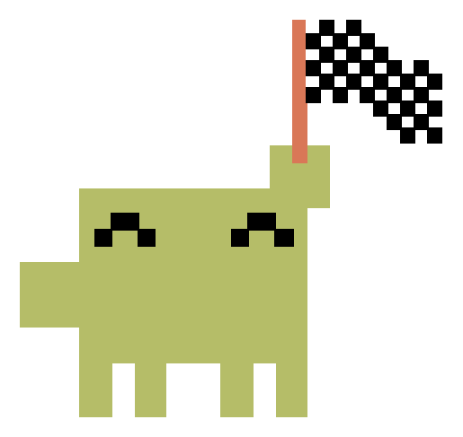
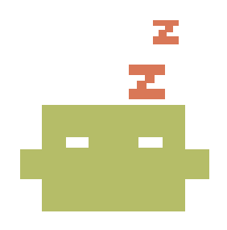
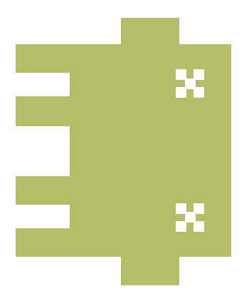

# Claude usage, on the back of the phone

Your Claude Code rate limits, live on the Xiaomi 17 Pro's rear display — so you can see
how much of your window is left without unlocking anything, opening anything, or asking.


Two accounts, three windows each, and a mascot that tells you the state at a glance from
across a desk.

> **Read [Please read this first](#please-read-this-first) before you sign in.** This is a
> personal project that handles account credentials and talks to an API on your behalf.

---

## The mascot

One per account, standing on its own 5-hour bar. Which one is playing tells you the state
without reading a single number.

### Walking — idle


**Nothing to report.** The window is somewhere in the middle and you are not currently
burning through it. It walks the length of its own bar, jumps back to the start, and
walks it again — a full crossing takes **11.5 seconds**, and it never leaves the bar it
belongs to.

### Lifting — you are working


**1% or more of the 5-hour window went in the last ten minutes.** It holds the pose for
five minutes after the last burst, and each new burst restarts that clock — so working
steadily keeps it lifting continuously rather than flickering between poses on every
poll.

### Flag — nearly out



**The 5-hour window is past 90%.** This outranks the lifting pose deliberately: checking
"are you working" first would hide the warning at exactly the moment it matters most.

### Sleeping — the window is spent



**The 5-hour window is at 99% or above.** Nothing left to do until it rolls over, so the
mascot sleeps it off. This outranks the flag, which is the warning that this was coming:
past 99% there is nothing left to spend carefully, and the warning has no job. It
outranks the lifting pose too — a burst cannot be happening against a window with nothing
in it.

Distinct from the dead pose below, and the difference is the whole point: this window
refills in a few hours. The week does not.

### Confetti — a fresh start


**The 5-hour window has not started.** Nothing spent, everything ahead of you. Only a
spent week outranks it — including a lifting pose still held from before the rollover,
which described what you were doing to a window that no longer exists.

Keyed on the window not running rather than on it reading 0%, and those are different
things. A 5-hour window begins at first use, so until you use something there is no
window at all. One that has started and rounds to 0% is a clock already ticking with a
few minutes gone — throwing confetti at it celebrates a fresh start that has quietly
already begun.

### Dead — the week is gone



**The 7-day window is spent** (99% or above). The mascot lies on its side with X-ed eyes.

Keyed on the *weekly* limit specifically, because that is the one you cannot wait out,
and it outranks everything below. A 5-hour window refills every five hours, so the moment
one rolls over you have a brand new session and a week still at 100% — and without this
rule the mascot throws confetti at an account with nothing left to spend it on.

### Ghost — nobody home


**The account has no usable credential** — never connected, signed out, or its refresh
token has expired. Grey and translucent, with white eyes: no legs, and a tail of four
blocks that tapers, fades out, and snakes as it falls, each one swinging wider and later
than the block above so the tip is still arriving where the head has already been.

It is the one pose that does not wear the account's colour. Every other mascot is
reporting on that account; this one is reporting that there is nothing to report, and
the palette saying "this is yours" about data that does not exist would be a small lie.

Not the same as dead, and keeping them apart matters. Dead is a fact about usage: the
week is spent, the numbers are real and all bad. The ghost is the *absence* of numbers —
nobody is answering, and there is nothing to report. Before it existed, a signed-out
account went on celebrating at 0% or waving the flag at 95%, replaying whatever reading
was last seen before it lost access.

### Which one wins

Several can be true at once, so they are ranked. The first line that applies is the one
you see:

| | when | why it sits here |
|---|---|---|
| **Dead** | the 7-day window is at 99% | the limit you cannot wait out — nothing below it matters |
| **Confetti** | the 5-hour window has not started | unambiguous: there is no burn to measure |
| **Sleeping** | the 5-hour window is at 99% | past this a warning has nothing left to warn about |
| **Flag** | the 5-hour window is past 90% | shown even while you are still burning through it |
| **Lifting** | 1% went in the last ten minutes | what you are doing, once nothing above is true |
| **Walking** | anything else | idling somewhere in the middle |

The three at the top describe **where you stand** and the two below them describe **what
you are doing**, which is the whole reason for the order: a warning you need is worth
more than an activity you can already feel.

## The rings and the bars

**The rings are arcs on bare panel** — there is no grey circle behind them. That ground
was there to say how much of a whole the reading was, and on a panel drawn around two
camera lenses it mostly said "there is a grey circle here": it read as hardware rather
than as a scale. The bars keep their tracks, because a bar is a rectangle in a list and
the ground is what makes the row legible.

**The rings are clocks, not gauges** by default. Each one shows the time remaining until
that account's 5-hour window resets, drawn concentric with the phone's actual camera
lenses. They fill as the window runs down, so a full ring means a reset is imminent —
good news. That is also why they are accent-coloured rather than ramped: a green-to-red
ramp would say the opposite of what a full ring means.

A ring can be pointed at a different window, switched to show **utilisation** instead —
in which case it *is* a gauge, and takes the ramp like a bar — or set to show **nothing**,
which empties it and fades it away. A bare lens surround is a legitimate look.

**The bars are utilisation**, one row per window:

| row | window |
|---|---|
| `ALL 5H` | the 5-hour session limit |
| `ALL 7D` | the 7-day limit across all models |
| `<MODEL> 7D` | the 7-day limit for the scoped model |

Each bar carries its percentage and the time until that window resets. They ramp green
through amber to red as they fill.

Both animate with a 1.8s ease-in-out rather than snapping to new values, so a change
catches your eye without you watching for it — and never overshoots, because a bar that
punched past 100% and settled back would be reporting a number the data never held.

## Two things the panel can be made of

A theme here is not a palette swap. It changes the face, the icon set and the material,
and everything on the panel follows it — including the settings screen, so the app you set
it from looks like the panel you are setting.

**ORIGINAL** is the panel as it started: Departure Mono, glyphs traced out of a terminal
font into pixel rectangles, flat fills, hard edges. Everything is drawn as rows of
rectangles because the panel draws all its own artwork that way, and shipping a whole
Nerd Font to render four shapes would have added megabytes to a 1.4MB release.

**GLASS** is Outfit, Material Symbols Rounded, and real refraction — built on
[AndroidLiquidGlass](https://github.com/Kyant0/AndroidLiquidGlass), whose AGSL is vendored
here with its licence. Every surface that was a filled shape becomes a pane that bends the
panel behind it: the notification cards, the unlock slider, the transport buttons, the
speaker, the controller, and a thumb on every bar and ring.

The lens is the reference's own, at the reference's own numbers, in the state its slider
thumb reaches when you press and hold it — because these thumbs are never actually held.
They are readings, and a reading that permanently looked mid-gesture would be a lie, where
one that permanently looks like the control's most solid state is simply what the control
is.

**Clear, never frosted.** There was a blur under the lens at first, which is what the
reference does to a thumb at rest, and it was the wrong half of that component to copy. A
blur is what a surface does when you cannot see through it; this panel's whole appeal is
that you can.

### The glass takes its colour from what is behind it

A fixed tint only works over a fixed backdrop. The notification card and the charging cell
were tuned against a black panel; put a photograph back there and a tint chosen for black
is a smear, while one chosen for the photograph disappears the moment the panel is dark.

So the panes read the backdrop and answer it — the reference's own method: scale the
backdrop to twenty-five pixels, average their Rec.709 luminance, drive the glass from
that. Twenty-five is not an approximation of a better answer; a pane covers a region and
what matters is the region's average, so throwing the detail away *is* the measurement.

Where this departs from the reference: it reads its backdrop back from a layer every
frame, on a phone showing one demo. This panel is always on, and a per-frame pixel readback
is the most expensive thing it could do — it stalls the render thread waiting for the GPU.
What is behind these panes is a background image and a ground colour, neither of which
changes between frames, so the grid is rebuilt only when one of them does.

The buttons get the same treatment inverted. They carry no tint at all by design, which is
right across most of the panel and wrong at the ends: over black there is nothing to see
through them and the disc disappears; over a bright photograph they are a hole with a rim.
They are given a tint *only* where clear glass stops working, and none in the middle.

### The settings screen is glass too

Under GLASS the app you set the panel from is made of the same thing the panel is. The
picture you chose for the panel's background becomes the wallpaper behind the settings —
or, with no picture, a soft gradient of the ground colour, because a flat colour gives a
lens nothing to bend — and every section sits on it as a card of glass, drawn by the same
vendored shaders with the same luminance grid deciding whether its text is black or white.
The toggles, the choices, the buttons, the sliders, the colour chips and the dialogs are
ports of the components in AndroidLiquidGlass's catalog app, rebuilt as Views because the
catalog is Compose and this app is not. The dropdowns became segmented controls, which is
what the catalog has for a choice.

**ORIGINAL does not change by a pixel.** Every glass control that is declared in the layout
is an inert twin of the platform widget it replaced until the theme says otherwise, and
that is tested rather than promised: a suite of tests inflates the layout under ORIGINAL
and checks that not one of them added a margin, a padding, a background or a drawing.

Every pane samples the wallpaper, not what is actually beneath it — a toggle inside a card
sees the picture, not the card. That is deliberate. Nothing reads the screen back, ever:
the wallpaper is one bitmap built once at the window's size, and its sixteen-by-sixteen
luminance grid is what every control asks. A still screen costs nothing, because a View
only redraws when it is invalidated. Scrolling redraws every visible pane over a new slice
of the picture, so the glass reads as sliding across it; to make that affordable, a card
refracts only its rim band — the shader passes straight through everywhere else and the
wallpaper is already painted behind — and a toggle at rest, which is an opaque white pill,
draws nothing under itself. Measured on the phone with a finger on it, a scroll went from
a median of 18ms a frame to 14ms after the rim change, which is still more than a 120Hz
screen allows; the two fixes after that are not measured yet.

Two things to know. The stored background is capped at 1024px on its long edge, which is
right for the panel and an upscale on the front, so the wallpaper there is softer than the
panel's — recorded, not fixed. And changing the theme rebuilds the settings screen rather
than restyling it, because the controls differ in kind.

## The preview shows what the panel shows

The preview on the front screen is the same view class as the panel, drawing the same
config — but it lives in a different process, and notifications and media reach the panel
by broadcast. It was never told, so it showed the readout and none of the things you were
there to configure. It now listens to the same broadcasts and asks the watcher what is
playing when it opens.

It is also inert: nothing on it can be pressed or dragged. It sits inside a scrolling
settings page, so before that every drag past it was handed to the panel's pager, and
scrolling the app quietly scrolled the preview onto the media page.

## On the front screen too

An ongoing notification carries both accounts, and on HyperOS it drives the
**HyperIsland** around the front camera:

```
CLAUDE USAGE
PERSONAL 100% · WORK 38% · ALL 5H resets 9m / 49m
```

Separate warnings fire at half of a limit, then at 90% and every 2% after that.

---

## The buttons on the panel

Both are off by default and both are toggles. The panel is otherwise a readout, and a
surface that reacts to being touched is a surprise unless it was asked for.

The rear display has **its own touchscreen** — a second digitizer at 904x572 — so a tap
on the back is a real tap, not a gesture forwarded from the front.

### Camera

Opens the system camera on the rear display, which is what turns the main lenses into a
selfie camera with a viewfinder you can see. The component and flags are MIUI's own, read
off a live trace of doing it by hand; the camera app then brings up its own companion UI
on the front by itself.

Closing the camera returns to the panel. Not an assumption — panel, camera on top, back,
panel again, measured. It also stops the camera: closing used to take its viewfinder off
the display and leave the camera app running behind the panel, lens open. It is asked to
die now rather than force-stopped, and the difference is that it actually goes.

### Game

Top-left corner, and a controller rather than a cross. Ripples the readout away and leaves
the mascot walking the bottom of the panel. Tap the mascot to bring it back.

It was a cross for a long time, which was an honest description of what the button did and
a poor one of where it goes. What is behind the readout is not nothing — it is the
mascot's own screen, and that screen is going to be something to play with. A cross says
"dismiss this"; a controller says "go there". For now the screen says **COMING SOON**,
centred on the part of the panel you can actually see rather than on the panel: the left
296 units are camera glass, so type centred on the true middle sits a third of the way
under a lens.

It scrolls away with the readout rather than being pinned across both pages. It closes the
*readout*, so on a page that is not the readout it would be a button for somewhere else.

Only the button closes the panel. That sounds like it goes without saying, and it did not:
the check was "was anything hit", which was true while the camera and this were the only
two targets, and every control added since quietly joined it — until a tap anywhere in the
media page's volume area swept the whole panel away.

It used to sit bottom-left, on the artwork's line. It moved because the media row wanted
that corner for a cover, and the top-left was the only genuinely empty space left: the
rings are drawn inside the display cutout and stop at 278, and the masthead is centred on
the bar column and cannot reach left of 377 even at its longest permitted title.

**Not a dismissal.** The panel keeps drawing, keeps polling and stays alive. An app that
dismisses its own panel cannot put it back — placement needs Shizuku and a task that
still exists — which is the failure this whole project is built around avoiding. What it
does instead is go quiet: the background drops to a low alpha and the system's own rear
screen shows through.

That alpha is never zero, and the code says so twice in capitals. At zero the panel stops
working entirely: with nothing occluding it, MIUI's SubScreenLauncher resumes, takes the
display, and this app's window leaves the window list while its process and task record
stay alive — a failure the respawn watchdog cannot see, because it asks whether the TASK
is alive and the task is fine.

The ripple radiates from wherever you touched, and it can be interrupted: change your
mind halfway and it reverses from halfway, with the remaining distance setting the
duration.

## When the panel lights itself

A notification or a charger will wake the rear display, so the panel is readable at the
moment the thing worth reading arrives rather than whenever you next happen to look.

Which creates a problem it has to solve on its own: **a phone that lights its own back
screen is very often in a pocket.** Every control on the panel is then under a thigh — the
volume strip, the transport, the page swipe. A screen that turns itself on has to assume
nobody asked it to.

So it refuses everything and shows a slider instead. Not a tap, because cloth taps; not a
tap on the right-hand end, because that is a tap with extra steps. A thumb has to land on
the knob where it rests, at the left, and carry it the whole way across without letting go
— three things in sequence, in one gesture, which a pocket does not produce.

It replaces only the art slot. The rings, the bars and the record stay where they are and
keep reporting, because the readout is the reason the display lit up. The transport and
the camera button leave with the same movement the slider arrives on, since a control you
cannot use should not be sitting there looking usable.

If nobody swipes, the panel waits for the notice or the charger to be gone, lets the
display go dark again, and puts the artwork back — all animated, including the record
spinning back up.

### And when nobody is looking

Thirty seconds after the last touch the rear display goes dark, unless **Keep panel awake**
is on. Dark is not dimmed: while it sleeps the panel draws nothing, fetches no reading, and
asks for no lyric sheet. The poll loop does not check a flag every few seconds and go back
to sleep — it parks on the panel's own signal and is not scheduled at all until the panel
says it is visible, so a phone in a pocket overnight costs exactly zero requests and zero
wake-ups. Two hours dark is the same as two minutes dark. The moment it lights, a reading
is asked for at once, and never more often than the normal cadence: glancing at it ten
times a minute asks for nothing extra.

Before this the frame loop was measured at 72% of a core, drawing into a display that
threw every frame away. A notification or a charger still wakes it, as above.

## Media controls

When something is playing, the bottom band becomes a player: cover, track, artist and
three buttons — sized to be pressed on the back of a phone rather than read, and evenly
spaced from each other and from the title. When it stops, the artwork comes back.

The row runs from the panel's left content edge to where the camera button starts, rather
than stopping where the bars stop. It is three things side by side where the bars are one
thing, and matching their column left 80 units of empty panel while the track title was
being clipped at thirteen characters. The gap before the camera is deliberately wider than
the row's own spacing: the camera opens another app, and at the row's rhythm it read as a
fourth transport button. One thing in that space at a time —
it is 70 units tall, and two things sharing it would be two things too small to read.

The swap is a wheel, the same one the notification strip turns on: the artwork drops out
of the bottom as the row rises into the top. So is the play/pause glyph, one size down —
pause rises as play falls, inside its own cell. A track being paused and the controls
arriving are then the same gesture at two scales rather than two unrelated effects.

**No new permission.** It runs on the notification access you may already have granted for
mirroring notifications: Android hands the active media sessions to whoever holds it,
which is why `MediaSessionManager.getActiveSessions` is given the notification listener's
own component. Without that grant the feature does nothing at all, and the settings row
says so under itself rather than pretending the switch worked.

It is still **its own toggle**, off by default. Two reasons, and the second is the real
one: this takes over a region you may have put your own picture in, and quietly covering
someone's artwork the first time they play a song is a picture going missing, not a
feature arriving. Agreeing to mirror notifications is not agreeing to that.

### The cover

Two styles, chosen in settings.

**Square** is the cover as the player supplied it, cropped to fill rather than
letterboxed.

Both styles get the media page. It was the record's alone at first, on the reasoning that
a square cover gives nothing to carry across the transition — which was wrong: the row's
thumbnail is an object too. It simply **travels and resizes** rather than spinning, growing
out of the corner beside the track name into the middle of the page and shrinking back on
the way down. A picture that rotated would be a picture on a turntable rather than a cover.

The record changer stays the record's, though. Flying a rectangle through a camera lens is
a conceit that belongs to the thing shaped like a record; a square cover changing tracks
simply becomes the next cover.

**Vinyl** is a record the height of the panel, sitting behind the readout — centred on the
half of the panel that is actually a display, and dropped far enough that a third of it
runs off the bottom edge. A record on a deck rather than a circle placed on a screen.
There is no thumbnail in the row under this style: the record *is* the artwork, and a
second copy of the same cover beside it would be the same picture twice.

It took two goes to stop looking like a CD, which is what you get when the cover art is
the whole disc. A record is black; its picture is a label the size of a fist in the
middle; and what you see across the rest of it is grooves.

It is a **photograph** of one now. It used to be constructed — a black circle, thirty-four
concentric strokes, a rim and two sheen arcs — and that is the honest limit of the
approach: it draws a diagram of a record. The things that actually say *vinyl* are how the
light runs in bands across the grooves and how the sheen falls off toward the rim, and a
stack of circles at graded alphas can gesture at those without ever claiming them. Worth
saying plainly that this bought nothing in speed: the whole constructed disc measured
0.2ms.

The disc does not turn, and that is deliberate rather than an omission — the image has a
fixed highlight lying across it the way a record under a lamp does, and spinning it would
spin the lamp with it. What it does instead is **lean**, a third of a degree at most, every
half second. Five degrees was the first attempt and read as a record being shaken; a deck's
play is the kind of thing you only notice once it stops.

Its **spindle is a hole**, cut rather than painted. It used to be a dot filled with the
panel's background colour, which is the same thing as a hole for exactly as long as the
panel's background *is* that colour — put a photograph back there and the record gains a
small flat disc of the wrong colour in its middle.

It is sheer on the readout and solid on the media page, thickening as you scroll between
them. The two pages want opposite things from it: behind six bars and two rings a solid
disc is a hole punched in the panel, and on the media page a sheer one looks like a picture
of a record rather than the thing.

The label does. It stops dead when the music does, which is the point — it is a second
reading of the transport state, legible from much further away than a 38-unit glyph on a
panel mostly seen from across a room. About 16rpm rather than 33, because a real speed is
a blur.

The rotation is accumulated rather than derived from the clock, so a pause stops it where
it is instead of letting it turn on invisibly and jump on resume.

### A progress bar under the row

A hairline under the row showing how far through the track you are. Underneath rather
than above: above put it directly below the last usage bar, where a thin horizontal line
in the same column is exactly what those are.

The position is **carried forward** rather than waited for. Players report a position only
when something changes, so a bar driven by reports would sit still for a whole track and
then jump; what crosses instead is a position, the clock reading it was taken at, and the
playback speed, and the panel counts on from there. Both processes read the same system
elapsed-time clock, so this is exact rather than an estimate. It respects playback speed,
and it stops when paused.

Anything with no duration — a live stream, a radio session — gets no bar at all, rather
than an empty one that is never true.

This bar and the dial on the record-player page read the **same** eased value rather than
each working one out. It used to take the position directly, which made it the one part of
the panel that was always right and never moved: on a track change it did not run down to
the new start, it was already there a frame after the old track left. That it looked
correct is exactly why it survived four rounds of work on the dial beside it — "the bar on
the main page is fine" was true, and was also the clue, because it was fine *by skipping
the follower that was broken*.

### Swipe up: the record player

With something playing, the panel has a **second page**. Swipe up from the readout and the
artwork moves to the middle while the readout leaves over the top of it; swipe down to come
back. It snaps: drag freely, let go, and it lands on a page.

Under **either** cover style. This was the record's page at first, on the reasoning that a
square cover gives nothing to carry across the transition, which turned out to be wrong:
the row's thumbnail is an object too, it simply travels and grows rather than spinning.

The artwork is the only thing that does not scroll. It travels between the two positions
instead — one object, two destinations, interpolated — so the panel turns into a record
player rather than sliding to a different screen. The **rings** are the other exception,
and they do not move at all: they are drawn concentric with the phone's actual camera
lenses, and a ring in motion is a circle visibly not on the lens it traces. What they do
instead is **sweep**, each one easing from what it reports about usage to what it reports
about the music as the page turns.

The page carries what the row cannot fit: the track and artist at full size and bigger
transport buttons. There is no progress bar — the playback ring is the position, and a
horizontal bar saying the same thing a hundred units below it is the reading twice, with
the second one competing for which is the real one. The two clocks that used to sit along
the bottom are gone with it: they were the same two numbers a third time, five hundred
units from the dial they belong to, and they now curve around the ends of the arc itself.

The snapping is deliberately forgiving — a short flick counts on its own, and anything
past a third of the way commits. This is a 904x572 panel on the back of a phone being
held in one hand, with no scrollbar and no edges to judge against; the alternative is a
surface that refuses to move and gives no reason.

It is built as a **page count**, not a two-state toggle, because the reason it exists is
that this panel will eventually hold more accounts than fit on it. Adding a third page is
a number.

### Changing tracks

Three different changes, because they are three different situations.

**A record on the media page** changes through the rings: the disc shrinks and travels into
the top one, and the next grows out of the bottom one, with a moment between where the deck
is empty. The rings work as the two ends of that because of the thing that made them
awkward everywhere else — a ring encircles a camera lens and there is no display inside
one, so a disc shrunk to ring size has genuinely *gone*.

A position **stamped before the track changed** belongs to the previous track, and is
ignored. Players deliver a track in stages — the same staging that put the wrong sleeve on
the record — so the first report carrying a new title can still carry the old position:
measured, a new title arriving with thirty seconds on the clock of a track that had only
just begun, which put the dial a sixth of the way round before it wound back. Not every
skip does it, which is what made it look intermittent. MediaSession stamps every position
with the clock reading it was taken at, so this is decidable rather than guessable.

During the gap in a skip — the moment where the player has dropped one track and not yet
started the next — the dial **holds** rather than carrying the departing track's position
forward. It is still flagged as playing, so extrapolating it ran it past its own end: the
dial filled to 100% on every skip and wound back from there, which is not returning to the
beginning, it is going the long way round first. What is left of a departing track is
whatever it last reported; it is not playing any more.

The dial follows the track continuously and only **eases when the reading jumps**. A change
smaller than one per cent of the arc is a tick — the destination moves and the clock is left
alone, so the dial tracks its target exactly. Anything larger is a seek or a track change and
gets the full easing. Without that distinction an ease-in-out restarted every frame, and
since ease-in-out begins each leg at zero velocity the dial never accumulated any: measured
sitting at one degree while its track ran sixteen seconds.

The playback dial **winds back** rather than snapping when a track ends: the reading goes
from nearly full to nothing between two frames, and a dial that jumps there reads as the
panel having lost its place rather than as a record finishing.

**A record on the readout page** has no rings to use, so it crosses instead: the old one
slides off the bottom while the new arrives from the top, at the same moment, the way a
stack feeds through.

**A square cover** never crosses. It leaves and the next follows it back in from the same
side — down and up again on the readout, out to the right and back on the media page. Two
pictures passing each other mid-air would read as a shuffle rather than a change.

Which one runs is chosen by the page rather than blended across it: a flight into a ring
and a slide off the bottom are different journeys, and halfway between them is neither.

The departing cover carries the departing sleeve — and it is held as a **bitmap**, captured
the moment the change begins, not looked up by path. There is one cover file and the new
track overwrites it, so asking for "the departing track's artwork" by path returns whatever
has since been decoded into that file: the arriving cover. That is how a record on its way
out ended up wearing the sleeve of the one replacing it.

### Lyrics

Off by default, and a **separate** switch from "Media controls" rather than part of it —
because it is the only thing in this app that sends anything anywhere. Somebody who wanted
a play button on the back of their phone did not thereby ask to tell a stranger what they
listen to.

With it on, each new track's title, artist, album and length go to
[LRCLIB](https://lrclib.net) over HTTPS. No account, no key, and nothing identifying the
phone or its owner goes with the request. Three things keep the cost down to that:

- Off means **no request is ever built**, not a request that is discarded.
- Every answer is cached, **including "there are none"** — otherwise instrumentals would
  generate the most traffic of anything, being the tracks that never produce a stored
  answer. A song on repeat leaks once, ever.
- The cache is filed under a **hash**, so a directory listing is not a listening history
  written in the clear. Turning the switch off **deletes** it: off means undone, not
  "stopped collecting".

A fetch waits 1.2s for the track's description to stop changing first. Metadata is staged,
so the first callback of a new track routinely carries the new title beside the *previous*
track's duration — and duration is both half the identity of a recording and the thing
LRCLIB matches on. Acting on that spends a request on a recording that does not exist.

On the panel: under the **vinyl** style the line being sung curves along the inside arc
against the record and the line coming next waits dimmed outside it, and on each change the outer line travels **inward**
and brightens while the old one sinks and fades. The record gives up the room — its size is
already derived from whatever is above it, so lyrics claim their band exactly the way a
notification does. Only a **synced** sheet is accepted; an untimed one cannot say which line
is being sung, and a fixed line of a song shown for its whole duration would be decoration
that looks like a reading.

The block fades in and out as a unit — switched on, scrolled to, a track turning out to have
words — which is a different event from a line being promoted and so gets a different
treatment: promotion travels because a song moving on has a direction; arriving does not.

Under the **square** style they are **straight**, stacked above the cover — sung line
closest to it, next line dimmed above that. A curve is what you do to text that has to
follow the edge of a record; a photograph has no edge to follow, and bending a line around
one anyway is decoration borrowed from a shape that is not there. Everything else is
shared: the same band, the same pair of lines, the same promotion, with "further from the
cover" meaning a larger radius in one and a higher baseline in the other. Straight lines
also get more room, so they shrink later than bent ones do.

**A notification wins.** With a group card up there is not room for both, and rather than
collapsing the record to a token with a ring of separate rotated letters around it, the
words fade out and come back when the card goes. The rule is derived from the record they
would wrap rather than written as "if a notification" — if any of the sizes move, the answer
corrects itself.

### The two drag controls

The media page carries three gestures on one surface, told apart by region **and** axis
together, so none of them can be started by accident from inside another:

| gesture | where | what |
|---|---|---|
| vertical | anywhere | turn the page |
| vertical | right sixth | volume |
| horizontal | the open area above the buttons | playback position |

They were the other way round first — the volume had the whole wide area and the position
had nothing — which put the one control with no width to it on the widest region, and left
a timeline with nowhere to be dragged.

The volume is **relative**, from wherever the finger lands, and applies live: you hear the
result, so there is nothing to confirm and nothing to take back. Its arc fills **upward**,
silent at the bottom, and the speaker glyph rides the head — a volume that filled downward
sent the speaker to the floor as it got louder.

The position is only **previewed**. Seeking live would have the player re-buffer on every
frame of the drag, so the dial and the clock move alone and one seek is sent on release.
While it is held the ring **doubles its stroke and greys**: the finger doing the driving is
on the far side of the phone and cannot be seen, so the ring has to say it is held, and grey
because a reading under a finger is a proposal rather than a fact about the music. Lifting
**outside** the area abandons the gesture — the dial is already pointed at the true position,
so letting go is the animation.

### Long titles scroll here too

Same marquee as the row: centred while it fits, and once it does not, left-aligned and
scrolling. Left-aligned because a marquee has to start somewhere fixed — centring a line
that is travelling means centring it on a different position every frame.

### Values turn over when they change

Title and artist roll on the readout's row too, on the same wheel — a long line both turns
over and then scrolls.

Title, artist and both clocks roll on a wheel when they change — the same drum the
notification strip uses — but only when they *actually* change. A track ending replaces
four fields at once and any of them may be identical across that change: two tracks from
one album share an artist, two of the same length share a total. Rolling a value to itself
is a flicker claiming something happened, so each field decides for itself.

The elapsed clock is the exception: it does **not** roll on its ordinary tick. A second
passing is the one change here that is expected, and a wheel turning once a second would
be the most distracting thing on the panel. It rolls when the number *jumps* — a seek, or
a new track starting.

### When a notification arrives on this page

It does **not** push the page down. Everything here is anchored to the bottom of the
panel — the transport buttons are the last thing on it — and pushing the page down put
them off the screen, where they cannot be pressed. The record gives up the room instead:
it shrinks to fit whatever is left, and the type and the buttons do not move at all.

**Lyrics give way entirely** rather than shrinking with it. Room for them is decided by the
record they wrap: with a group card up it would collapse to its floor, and a sentence bent
around a token is a ring of separate rotated letters rather than a line. So the words fade
out for the card and come back when it goes — see [Lyrics](#lyrics).

The readout also stops riding the strip once it is off-page. It sits a full panel height
above, so pushing it down slid its bottom edge back into view underneath the card — a
strip of the first page visible behind a card on the second.

### The rings become the player

The best thing on this page needed nothing invented: there are already two rings drawn
concentric with the phone's actual camera lenses, and on this page they had nothing to
say. So the **top ring becomes the playback position** and the **bottom one becomes the
volume** — two dials, on the two pieces of hardware that look like dials.

They do not fade out and get replaced. As you scroll, each ring **sweeps** from what it
reports about usage to what it reports about the music. Cross-fading was the first attempt
and it looked like two rings in the same place, which is what it was.

The playback dial is labelled at both ends: **elapsed curved at the arc's start**,
**total at its end**. Their digits roll **individually**: 1:21 to 1:22 moves one digit, not
the whole clock. Rolling the whole string makes one second look like a change of track,
which on a panel read out of the corner of an eye is the difference between "time is
passing" and "something happened". The volume label carries its reading the same way —
`VOLUME 42%`, one wheel per character, so the word acts as the unit and only the figures
that changed move. Nothing in the middle — a remaining-time counter lived there for a
while and it was the same fact a third way, since the arc already shows what is left as a
shape. There are no clocks along the bottom of the page either; they were the same two
numbers again, five hundred units from the dial they belong to.

The curved labels are **thickened** with a stroke over the fill rather than a bold weight,
because there is no bold weight — Departure Mono ships one face. They are the thinnest type
on the panel, bent, anti-aliased and sitting over camera glass at the very edge of the
display, which is the least favourable place type can be; they are the only text here that
gets it.

Every label sits **outside** its ring, and that is a constraint rather than a preference:
a ring is drawn concentric with a camera lens, and the lens fills the hole. There is no
display inside a ring — anything put there renders perfectly into the framebuffer and onto
a piece of glass.

It is a tight fit. The two rings are 276 apart with a radius of 128 and a stroke of 25, so
there are about twenty units of panel between them, and outside the top of the lower ring
is *inside* the upper one. The labels are therefore placed where there is room rather than
where they would look tidiest. The two ends of the playback arc also face opposite ways:
text stands perpendicular to its path, so tops-outward reads correctly around the upper
half and tops-inward around the lower.

Each arc is marked at both ends by a **hairline pointing straight out of the ring**, in the
arc's own colour. With no groove behind them a silent volume showed nothing at all, and a
control you cannot find at zero is a control you cannot turn up.

The playback arc is **turned half an hour** to make room for those labels — it starts at
eleven rather than half past ten and ends at half past five rather than five, running the
same length. The labels stay where they were, so what the turn opens is the angular gap
between each label and its own mark.

Turning the dial is the right axis for it. Sliding the whole ring sideways was tried first:
it made room, and it moved a ring drawn concentric with a camera lens, which is the one
thing about these that must not move. There is nowhere to move the labels *to* either —
outside the top ring there are 63 units of panel on the diagonal and a mark plus a label
wants most of that.

Anything attached to a ring is drawn in the **ring's frame**, with the burn-in drift undone
around it. The rings are the one thing on this panel that deliberately does not drift — they
trace the camera lenses and must stay on them — while everything else rides a translation
that wanders a few units on a ten-minute cycle. Marks and labels drawn in the page's frame
were therefore sliding against a ring that never moved: sometimes clear of it, sometimes
touching, sometimes overlapping, and never twice the same. That is what "some are aligned
and some are not" turns out to be.

Perpendicular, and that is the whole of it. Drawn *along* the ring the mark is an arc of the
same circle as the reading, in the same colour — indistinguishable at a glance from a bit of
arc already filled in. Crossing the scale rather than lying on it is what a mark on a dial
has always looked like.

Both are **gauges rather than full circles**, and their gaps face each other: playback
runs from eleven round to half past five, volume from half past one to half past four.
Each was turned back from where it started — the playback arc to open an angular gap for
its labels, the volume arc because five o'clock is the bottom-right corner of a panel 572
tall with that ring centred 420 down it, and the arc's end and the speaker riding it were
pressed against the edge. Two dials with their
openings pointing at one another read as a pair; two closed circles read as two lenses
with rings drawn on them. The gap at the bottom of the playback ring is also where its own
label sits. A
speaker rides the head of that arc and turns with it, so the glyph is the arc's pointer
rather than a legend parked beside it — where it is *is* the value.

The volume arc fills **upward**: silent at the bottom of its segment, loudest at the top.
It ran the other way first, and the speaker is the reason that was wrong — a volume filling
downward sends its own pointer to the floor as the music gets louder, backwards against
every volume ever drawn and backwards against the drag that sets it.

That speaker is drawn at **one and a half times** its original size with three rounds of
spacing off the ring, and it **stops short** of the arc's silent end rather than riding it
the whole way: the lower ring is centred 420 down a 572 panel, so past a certain angle a
glyph that big lands half off the bottom edge. The limit is worked out from the sizes
rather than written down as an angle, so it corrects itself if any of them move. Note that
the glyph is *centred* on its orbit, so half its height comes out of the clearance too —
missing that is what once made a stated gap of ten read as stuck to the ring.

Under GLASS the speaker sits on a disc of glass like every other control that does
something when tapped — it was the last one still drawn as a bare mark, which read as a
label for the ring rather than a thing to press. **The bubble holds the sound:** it is
sized from how far the outermost wave has travelled, so it opens as the waves leave the
cone and closes as they come back. Sized to *exactly* contain them it looked like a bubble
straining to hold something, so the reach is curved — most room where the sound has gone
least, none at all at full volume — which also keeps the glass ahead of the wave at every
point in between.

### Setting the volume

A **vertical drag in the strip down the right-hand sixth** — see [the two drag
controls](#the-two-drag-controls) for how the three gestures on this page stay out of each
other's way. That is where the volume keys are on the front of this phone and it runs the
same direction: up is louder, which is also the way the arc fills.

It is **relative**, from wherever the volume already was, and this was tried both ways
round on the way here. An absolute strip has ends — silence and maximum become places
rather than distances to travel — which sounds better than it feels: it turns every touch
into a commitment to a level, on a surface nobody is looking at. Relative means the gesture
is "louder" and "quieter", and a stray tap does nothing at all.

It had the whole area above the buttons and a sideways drag until the playback position
needed somewhere to be scrubbed. That arrangement gave the widest region on the page to the
one control with no width to it.

There is a **haptic tick per step**, so it can be set without looking at a screen facing
away from you. The tick is on the step, not on the movement; a buzz per frame is a rattle.
And the ring moves **linearly** with no easing while your finger is down: easing exists to
make a value that jumps read as a movement, and a value already being moved by hand does
not jump — smoothing it only puts the ring behind the finger dragging it.

**Mute** is a compact button just clear of the cutout that tracks the speaker's height. It
cannot *be* the speaker: the lower ring is drawn over camera glass with no digitizer behind
it, so wherever the arc carries the glyph is somewhere a finger cannot reach. It was
briefly a tap anywhere in the volume area, which meant every stray touch on two thirds of
the page silenced the music.

**Muted is not the same as turned all the way down**: a muted stream is holding a level it
will come back to, where a stream at zero has lost that number. Both show the bare
speaker; muted adds a slash cut through it. This uses Android's own mute rather than
zeroing the volume and remembering the old value in a field, so the phone and the panel
agree in both directions.

### The buttons wait before believing the player

Press next and the player reports three states in a few hundred milliseconds: the old
track stopping, a gap while the new one loads, then playing. Acting on each one made the
play/pause glyph flick to play and back on every skip.

So a report is not a verdict. A state has to hold still for half a second before it
counts, and one that reverts inside that window never counts at all — **unless the panel
asked for it**. A report that matches the command just sent is evidence, because the
player is answering a question this panel put to it, so a press of play or pause shows at
once. The suspicion is for reports that arrive unbidden.

A skip gets a longer guard still, started when the panel sends next or previous rather
than inferred from the title changing. Inferring it had a hole: a skip that drops the
session produces no new title to compare, and by the time the track returns there is no old
one left to have changed from. The cost is honest: a
real pause takes half a second to show. The button has already been pressed by then, and
one that answers deliberately beats one that twitches under the finger.

The same rule guards **whether anything is playing at all**, and it has to. A skip does
not hand one track to the next: the player drops the session while it loads, so a row
driven by every report tore itself down and rebuilt on every press of next — the record
slid off the bottom and climbed back, and on the media page the whole page went away and
returned. A gap that comes back inside the window is never reported. One that does not is
a real stop, and then the record leaves properly: it slides down and off the panel, and if
you were standing on the media page, the panel walks itself back to the readout rather
than cutting.

### Long titles scroll

A track title that does not fit the column is not cut short — it scrolls, and a second
copy follows a gap behind it so the line never rewinds and is never blank. It holds still
for a moment at the start of each lap, because a line that starts moving the instant it
appears is one you have to wait a full lap to read from the beginning.

This is the opposite of what the notification strip does, deliberately. That strip is up
for five seconds and the first few words are the whole point, so it ellipsises. A track
plays for minutes; there is time to show the rest, so the rest is shown.

### The cover, and why it kept lagging

The cover is written to a file and passed as a path, and the cache key for that file is
the thing that took three attempts to get right.

Players do not deliver a track in one piece: **title and artist arrive first, artwork in a
later callback**. Keying the cache on the track meant the early callback wrote the *old*
picture under the *new* track's name, and the callback carrying the right picture was then
dismissed as a repeat — the cover ran exactly one album behind.

Keying on the artwork's URI looks like the fix and is the same bug one layer down: the URI
is metadata too, and it updates with the title while the bitmap beside it is still the
previous track's. The key now identifies **the bytes being written** — a bitmap by its own
generation id, a URI-sourced cover by that URI — so it cannot be fresh while the picture is
stale.

### What crosses to the panel

Text, and one small file. Title, artist, and whether it is running. The cover is scaled to
140px, written to the app's own storage and passed as a **path** — a bitmap in a broadcast
is copied through the binder, which has a hard limit around a megabyte shared with every
other transaction in flight. It is written to a temp file and renamed, because the panel
may be decoding the previous one at that moment, and an atomic rename cannot be caught
half-written.

The buttons work the other way round. The panel has no media session of its own — a
`MediaController` belongs to the process that obtained it, and `:rear` holds no
notification access — so a press is a broadcast back to the main process, which owns the
controller. Nothing is guessed on the way out: the panel does not flip its own glyph
optimistically, it waits for the player to say what happened. A play button that refused
to start should not look like a pause button.

### If several things are playing

The foremost one, as the system ranks it. Not a merge: a browser tab and a podcast paused
an hour ago can both hold a session, and a row that showed whichever answered first would
swap around under your hand.

A session with no title is ignored — a game that took audio focus, a page with a video
element on it — because an empty row is worse than the artwork it replaced.

## Notifications from other apps

The panel can mirror your other notifications. It needs **notification access**, granted
by hand in Settings — the onboarding list has a button for it, and that step ticks itself
once done.

A notification slides a card down from the top over a quarter of the panel and pushes the
readout down with it. **The rings do not move**: they are drawn concentric with the
phone's actual lenses, and shifting them would put two circles a hundred pixels from the
hardware they trace. It holds for five seconds, then retracts.

If another arrives first, the two change places on a **wheel** — the new one enters from
the top as the old one leaves through the bottom, like a drum turning behind a window.
Sending the outgoing one back up the way it came would read as "cancelled"; continuing
downward says the next thing is already here.

### Groups

Apps that can produce several related notifications post each one **and** a summary
standing for the lot — WhatsApp sends the message, then "2 messages from 2 chats" a
moment behind it. Both are real notifications, and the summary arriving second used to
replace the actual message a split second after it appeared.

The summary is dropped and the group is shown instead: the newest message as the
headline, and the next one in a smaller card attached underneath, stepped in on the left.
That card follows the headline in and leaves ahead of it, so it reads as a consequence of
the first rather than one object changing size.

Neither card has a border. They carried a hairline stroke at a tenth of the notification's
colour, doing two jobs badly: separating the card from the panel, which its opaque ground
already does, and separating the two cards from each other, which the step between them
does. It was a third edge on a shape that has two.

What tells you which card is in front is a **shadow** instead. The two are the same colour,
so the join between them read as one shape with a step in it rather than as one sheet lying
over another; the second card now takes a gradient from its top edge, spent by half its own
height. Any further and it stops reading as depth and starts reading as a darker card — the
fade is legible as a shadow only while you can see where it ends.

The second card is **taller than the band it shows in** and sits *behind* the headline,
tucked up by a full corner radius with its contents padded down by the same amount — so
nothing visible moves, and its square top corners are hidden. Without that, two cards of
similar width met at a seam where the headline's bottom-left corner curved away and the
card below did not, and the eye read the lower one as the upper one clipped rather than
as a second card. The step on the left is derived from the corner radius rather than
fixed, so it clears the curve on any display instead of clearing it by two units of luck.

A notification from a **different** app has no sibling, so the second card collapses as
part of the same turn.

Also filtered, and none of it is news: ongoing and non-clearable notifications, anything
an app declares as `SERVICE`, `PROGRESS` or `TRANSPORT`, this app's own, and any repeat
of something already showing. That last one matters more than it sounds — a single post
delivers **twice**, milliseconds apart, because the system re-delivers on ranking changes.

### What it shows, and what it does not

| | |
|---|---|
| **Always** | The app's name, its icon, and the notification's title. |
| **Only if you ask** | The message body. It is a **separate switch** from the feature itself. |
| **Never** | Actions, images, or anything else in the notification. |

The reason for that middle row is worth stating plainly: **this display faces away from
you.** Everything on it is shown to whoever is behind you rather than to you. Knowing
that a message arrived and broadcasting what it said are different decisions, so they are
different switches, and both start off. With the body switched off the group cascade
lists **senders** rather than falling silent — the panel still says who is waiting.

## The page above the readout

Scroll up from the readout — the media page is below it, this is above — and the panel
slides to a page with the time on it. Not fades: slides, the way the readout does, so the
pages are things stacked on the display rather than states of one thing. The clock has
seconds, and every digit turns over on its own the way a wheel picker turns, so a second
ticking is one numeral rolling and not a whole clock redrawing. Under GLASS the numerals
are made of glass, the way the charging percentage is; the date is spelled out in full —
`Thursday, September 3rd, 2026` — in a shell of glass, and both take the colours the
readout's own clock and date use. Under ORIGINAL they are the original traced glyphs.
Under the date, whenever there is a reading to show, is the weather — see [what it is
actually doing outside](#what-it-is-actually-doing-outside).

Under the clock are the **last ten notifications**, on a wheel. The current one is whole
and in front; its neighbours sit half a card behind it, smaller and faded, and the wheel
settles on a card the way the pager settles on a page. The ten are kept, so the message
that woke the panel at three in the morning is still there when you look at it at seven —
the display lit for it and went dark again, but the notification did not leave with it.
Under ORIGINAL the cards are the original opaque ones; under GLASS they are the same
glass cards the strip uses, and each reads the panel behind its own place on the wheel.

The small line under a notification is its group's summary — WhatsApp's "3 messages from
2 chats" — not an older notification pretending to be related. The record sinks to the
bottom of this page so the cards have the room.

## Charging

Plug the phone in and a cell slides in from the right edge and fills with liquid.

It is liquid rather than a bar, and that took three attempts to get right. Drops were the
second and metaballs the third, and both were the wrong shape of answer: blobs merging and
pulling apart is what happens to liquid moving through *air*, and this is a vessel with
liquid sitting in it. However well a heap of circles is packed, the eye keeps finding the
lumps — because a still liquid in a glass does not have any.

What it has is a **surface**: one smooth line that ripples when disturbed and settles flat
when left alone. The level knocks it as it passes each tenth, so the arriving charge
disturbs the water instead of sliding up under a sheet of glass. Charge going in shows the
way a cloud shows it — lit from inside, the source never visible.

**It knows which way is down.** The surface is worked out from the gravity sensor, so
turning the phone over tilts the water. The drawn direction lags the measured one on
purpose: following the sensor exactly makes a rotation a teleport, where swinging the
direction round means the surface tilts through every angle in between — the liquid going
round the glass rather than reappearing somewhere else.

Under GLASS the cell is a real glass: the readout and the record bend through the empty
part above the water line, and **the liquid magnifies**. That is the tell that there is
something in there — what is behind the cell steps as it crosses the surface. The lit line
along the meniscus goes when that happens, because the magnification already says where
the surface is, and the two together read as two tops a hair apart.

The percentage stands beside the cell at the height of the water and rises with it, so the
figure is a label *on* the level rather than a number placed near it. It counts from the
same fill the surface is drawn at, so the reading and the picture cannot disagree. It
grows in and shrinks away on the cell's own timings — a number that fades in was already
there and became visible; one that grows was brought.

Under GLASS it is made of glass too, at the heaviest weight the face has, carrying a wash
of whatever colour you chose for the liquid. That wash is a fifth opaque, not more: at
higher strengths the tint becomes most of what you see and the refraction underneath is
averaged into a flat colour, which is coloured type rather than tinted glass.

## Weather on the glass

A setting, **None, Auto, Rain or Snow**, draws weather on the ground behind everything —
on the colour or the picture, and in front of nothing, so the readout stays readable and
the cards bend the weather along with whatever else is behind them.

**Rain is water, not sprites.** A drop is drawn as displacement: it bends what is under it
and only then gets a lit edge, because a lens is what the eye recognises long before it
notices a highlight. Drops cling, run, wander sideways when they catch on something and
slow where they slip, leave beads behind on their own spacing and a trail that lingers a
couple of seconds, and wipe the condensation clear along their path, which mists back over
in about three. Each trip down a cell is a different drop — a different start, a different
route, a different rate — because a cell that ran the same drop forever read as a video on
loop, which is exactly what it was. They are lit by which way their surface faces, so no
two look alike, and a running drop takes the smaller ones it crosses and grows a little for
it. And the water goes round the cameras. A drop cannot do that on its own, since it lives
in a cell narrower than the lens; so the panel is folded along the line through both lens
centres by the rim's width at each row, the columns part around it, and a straight fall
comes out on the screen as a curve that hugs the ring. The trail and the wiped path follow,
because they are drawn along the same route.

**Snow is dry.** A flake sits on the glass rather than wetting it, so it bends nothing —
snow that refracted looked like rain that had forgotten how to fall. It is adapted from
Lumine's multilayer snowfall: diamond flakes, a fall that slants differently per layer,
and a focal depth that drifts so the sharp plane moves through it. Fourteen layers rather
than its forty, which is a desktop budget.

Rain costs more than snow because it refracts, which is a dependent read the GPU cannot
prefetch; measured at three layers each, snow was a millisecond a frame and rain sixteen,
so rain gives up a layer. There is no blur under either: a downscaled blur went blocky and
came out, and the bending carries the whole illusion on its own. The rectangles that
appeared on the condensation for a while were chased through six explanations — tiling,
the effect, the noise, the compositing — and were a missing term in the water field: the
clearing knew how far *above* the drop a pixel was and nothing about how far to the side.

### What it is actually doing outside

The page above the readout carries a second reading, under the date: the condition's icon,
and then `20° · Overcast` — the temperature in whole degrees, a middle dot, and the word for
the sky. Whole degrees, because a tenth of a degree is a digit with nothing to say on a
panel read from across a room.

The place it is for goes **underneath**, on its own line, centred, smaller and dimmer. It
was a suffix on the end of the reading first, at eleven units, which is legible on a laptop
and unreadable on the panel it is actually printed on; sixteen is the size a caption on this
page already is — a notification's body — and a second line has the room for it. Under
GLASS the two lines share **one** card of glass, cut to whichever of them is wider, because
they are one reading with its source named under it rather than two things sitting near
each other; the temperature's digits are glass numerals like the clock's, and the words
beside them are plain type in both themes. Under ORIGINAL the whole line is flat type with a
glyph traced out of the same terminal font as every other icon here.

That card reaches down into the unlock slider's band, so **the whole block leaves when the
panel locks** and comes back when it unlocks — the same bargain the artwork makes with the
lock, and [When the panel lights itself](#when-the-panel-lights-itself) is why the slider is
there at all. The clock and the date do not move up to make room: nothing on this page
moves, so it is a fade rather than a shuffle. The one thing that changes on the way out is
the temperature, which drops back to ordinary type for the trip — a glass numeral is a
refraction rather than an ink, and asked to fade it simply would not, leaving the figure
standing at full strength over an empty card.

The conditions are Open-Meteo's WMO codes, collapsed to ten readings and eight icons: clear
— a sun by day and a moon by night — partly cloudy, overcast, fog, drizzle, rain, showers,
snow and thunderstorm, with the three kinds of wet sharing a glyph because they are one
picture. A code outside the documented ranges reads as overcast, which is the least wrong
thing to say about a sky that cannot be read. The icons came out of the same two generators
as every other glyph on the panel: Material Symbols Rounded under GLASS, traced rectangles
under ORIGINAL.

Where the reading is *for* is two settings and a rule. **Place** is typed once and resolved
once — the geocoder is asked 800ms after the last keystroke, and the coordinates it answers
with are what every poll after that uses, so nothing is looked up on a schedule. The note
under the field says what it made of what you typed, `Weather for Bucharest, Romania` or
`Not found`, and carries Open-Meteo's attribution beside it; a typo is then visible where it
was made rather than as an absence on the back of the phone. **Use the phone's location** is
the other, and it asks for coarse location only when you turn it on, and turns itself back
off if you refuse — a switch that stayed on without the permission would be describing a
fetch that had quietly fallen back to the typed place.

With that switch on, the reading is for wherever the phone is, and the rule is what the line
says underneath it: `Here` when nothing is typed, and nothing at all when something is. The
service will give a reading for a coordinate and will not name it, and printing the typed
place under a reading taken two countries away would be a lie in small type. A fix that
never arrives falls back to the typed place, which the line can go back to naming.

A reading every five minutes, and only while the panel is awake. The loop parks on the same
signal the usage poll parks on — see [And when nobody is
looking](#and-when-nobody-is-looking) — so a phone in a pocket asks for nothing at all, and
a panel that lights up asks at once. Setting a place, or turning the location switch on,
cuts the wait short rather than leaving the line wrong for five minutes; a change made while
the panel was dark is answered by the reading the wake-up already takes, rather than by that
one and a second behind it. A fetch that fails keeps the last reading, because a stale fact
beats a blank line — but only so far: anything older than **two hours** is dropped rather
than shown, by the line and by Auto both. A two-hour-old sky is a guess dressed as a fact.

**Auto**, the fourth answer on the Weather row, hands the choice to the real weather: rain,
drizzle, showers and thunderstorms bring the rain, snow brings the snow, and everything else
leaves the pane dry. With no reading, or one that has aged out, it draws nothing — a guess
about the sky is worse than a dry pane. It is the only one of the four that can turn itself
off, which is the whole of the difference: None, Rain and Snow are decisions about the
panel, and Auto is a decision about the weather.

In a debug build the demo carries a reading of its own — a fixed 12° of rain for `Somewhere`
— so the line and the rain are both in the filmed loop with no network behind them.

## Customisation

Almost everything on the panel is editable, and the settings screen shows a **live
preview of the real panel** pinned at the top — not a mock-up of one. It is an actual
instance of the same view at the same 904x572, scaled down, so it animates and it cannot
drift from what the back of the phone is doing.

| | |
|---|---|
| **Titles** | The masthead — `CLAUDE USAGE` by default — and every account name. All free text; the masthead is a label, not a brand mark. Each is capped at what it can actually draw, measured off the real font rather than guessed, and each field says its own limit. |
| **Colours** | Every element carries its own, on the row of the thing it paints rather than in a grid somewhere else: the masthead, the background, the clock, the date, the weather line, the battery, the camera and game buttons, the notification strip and its ground. Plus a per-account **accent** driving that account's ring, heading, row labels and plan tag together, each mascot's body and hardware colour separately, and the ramp stops from mild to spent. (The ghost is the one exception — see above.) |
| **Layout** | Which bar rows each account shows and in what order, whether it shows a mascot at all, and what each ring reports — which window, and whether it shows time-to-reset, utilisation, or nothing. |
| **Account order** | Reorder the accounts and the rings follow them: ring one belongs to whichever account is first, so there is nothing to keep in step by hand. |
| **Bottom artwork** | Replace the built-in mark with your own image, dragged and pinched into position within its region — you choose the crop, against a frame at the region's real shape. |
| **Background picture** | A photograph behind the whole readout, cropped the same way the artwork is. Under GLASS it is also the best thing that has ever been behind a pane — the lenses had almost nothing but flat black to bend until it arrived. |
| **Extras** | A clock, a date and a battery readout, stacked in the corner with pixel-traced glyphs, each its own toggle and its own colour. |
| **Background** | One section, three columns: a colour, a picture, and a bin that is live only when there is a picture to empty. They are exclusive — choosing a colour clears the image, because the picture is drawn *over* the ground and would otherwise go on covering whatever you picked. There is no switch for the ground itself: a panel with no ground is the one state that hands the display back to the system's own launcher. |
| **Theme** | ORIGINAL or GLASS — the face, the glyphs, the material, and the settings screen with it. First in the list, because it is the one setting that changes what every other setting looks like. |
| **Weather** | None, Auto, Rain or Snow, on the ground behind everything. Auto draws whatever is actually falling where the reading is for, and nothing at all when the sky is dry or there is no reading. |
| **Weather line** | The reading itself, under the date on the page above the readout. A swatch and no switch: the line is there whenever there is a reading, and the two rows below decide whether there is one. It takes the date's colour until it is given one of its own. |
| **Place** | Where the weather is for. Typed once and resolved once, and the note under the field shows what the geocoder made of it — or `Not found`. |
| **Use the phone's location** | The reading follows the phone instead, on coarse location that is asked for only when you turn this on. Refuse the prompt and the switch goes back off. |
| **Keep panel awake** | Off by default: the panel goes dark thirty seconds after you stop touching it and does no work while it is dark. On, it stays lit. |
| **Accounts** | One or two, each with its own name, colours, and choice of browser sign-in or pasted token. |

Each account gets **its own settings screen**, reached from a row on the main one and
sliding in over it, with a preview showing just that account's ring and rows. Two
accounts already made a single screen a long scroll, and the panel is meant to grow past
two.

Colours are chosen on a **saturation/brightness square with a hue strip**, or typed as
hex, or taken from the panel's own palette. Every colour change eases in over 1.8s
exactly as the bars do, in the preview and on the panel, so a setting being dragged looks
like the panel responding rather than flickering.

### Who an account belongs to

Each account's settings can show the holder's name, email, organisation and plan — enough
to tell two accounts apart when you have forgotten which is which. It is **masked until
you unlock it** with your fingerprint or device PIN, the way a banking app does it, and it
re-hides when the screen locks, when you leave the screen, or after 30 seconds. A phone
handed to someone else should not show whose accounts these are.

### Starting over

**ADVANCED → Reset every setting to its default** puts everything back. It asks first,
and the confirm button stays shut for five seconds — the one action in the app with
nothing behind it and no undo. Your connected accounts stay signed in.

### The demo, in debug builds only

A debug build has one more switch, **Demo mode**, and the panel then performs itself on a
loop for the camera: every mascot state in turn, the bars and their colours and reset times
driven per segment, an account that is not answering, the volume and the playback position
swept and a track change, and ten invented notifications wearing the icons of apps that are
actually installed — written rather than borrowed, and dull on purpose, because the whole
point of filming a notification page is not publishing a stranger's messages. The wheel
turns itself. None of it is in a release build.

## Future plans

- **ChatGPT Codex** — a second provider beside Claude, so one panel covers both.
- **Android widget** — the same readings on the home screen, for phones with no rear display.
- **iOS widget.**
- **macOS widget.**
- **More than two accounts**, scrolled vertically on the panel rather than stacked — which
  is why colours are named per account rather than "primary" and "secondary". The panel
  overflows at four today: 516px of content into 396px of room.
- **Per-region click-through**, so the readout could pass touches to whatever is behind
  it and leave only the buttons live. Investigated and **not currently possible**: the
  only API for it needs `touchableRegion` on `ViewTreeObserver.InternalInsetsInfo`, and
  that field is simply absent on this build — probing the class lists `contentInsets`,
  `mTouchableInsets` and `visibleInsets` and nothing else. Not the hidden-API blocklist,
  which would also have hidden `setTouchableInsets`, and that resolves. The `CONTENT`
  fallback installs without error and does nothing.
- **A game behind the readout.** The controller in the corner already goes somewhere: a
  screen with the mascot walking it and `COMING SOON` written across it. The intention is
  a Tamagotchi — the same animal that reports your usage, with something to do when you
  are not reading numbers off it.
- **Mascot states that enter and leave**, rather than looping whole. The lifting mascot
  should put its headband on once, lift for as long as you are working, and take it off
  when you stop — instead of restarting the whole performance every three seconds. And
  the cut between one state and the next should stop being a cut.

---

## Requirements

- **A Xiaomi 17 Pro.** The rear display's size, position and lens geometry are measured
  into this app. It will not do anything useful on another phone.
- **HyperOS 3, Android 16.** Developed and verified against **`3.0.318.0`**, the current
  stable. **It has not been tested against the HyperOS 4 beta** — the placement mechanism
  depends on system internals that have already changed once between releases, so assume
  it needs re-verifying there.
- **[Shizuku](https://shizuku.rikka.app/)**, running. Non-negotiable — see below.
- A Claude account with Claude Code access.

## Shizuku, and why you cannot skip it

The rear display will not host an app you simply launch at it. Getting a window there
needs a privileged call that no ordinary app may make. **[Shizuku](https://shizuku.rikka.app/)**
is what bridges that: it runs a small service with shell-level privileges and lends them
to apps you approve. Without it running, this app has no way to put anything on the back
of your phone.

**Be warned that it is finnicky.** It does not survive a reboot on its own, some ADB
operations knock it over, and when it is down this app simply cannot place the panel.

### Starting it

1. Install **Shizuku** from [shizuku.rikka.app](https://shizuku.rikka.app/) or the Play
   Store.
2. On the phone, enable **Developer options** → **Wireless debugging** (Settings → About
   phone → tap *OS version* seven times, then Settings → Additional settings → Developer
   options).
3. Open Shizuku and use **Start via Wireless debugging**. It walks you through pairing.
4. Open this app and grant Shizuku permission when it asks.

**After every reboot, Shizuku must be started again.** Its own notification is the
quickest route back.

If you have a computer to hand, `adb shell sh /storage/emulated/0/Android/data/moe.shizuku.privileged.api/start.sh`
restarts it without touching the phone — useful when an ADB session has killed it, which
does happen.

## Please read this first

**THIS PROJECT IS NOT AFFILIATED WITH, ENDORSED BY, OR CONNECTED TO ANTHROPIC, OPENAI, OR
XIAOMI IN ANY WAY.** It is a personal project by one person. "Claude" and the Claude
mascot belong to Anthropic; "Codex" belongs to OpenAI. Their appearance here is
description and fidelity, not affiliation.

**THIS APP COLLECTS NO DATA. NONE.** There is no analytics, no telemetry, no crash
reporting, and no server belonging to this project. You can check that claim rather than
trust it — the only network destinations in the entire source are:

```
https://claude.ai/oauth/authorize       sign-in
https://api.anthropic.com/              your usage figures
https://platform.claude.com/            your plan tier
https://lrclib.net/                     lyrics, if you switch them on
https://api.open-meteo.com/             the weather, if you ask for it
https://geocoding-api.open-meteo.com/   the place you typed, turned into coordinates
```

The bottom three are the optional ones, and what they are told is the whole of what they
are told. LRCLIB is sent a track's title, artist, album and length, and only with lyrics
switched on — see [Lyrics](#lyrics) for what that costs and what is done to keep it to
that. Open-Meteo is sent a latitude and a longitude for a reading, or the place name you
typed when that is what is being resolved, and it is sent nothing at all until you set a
place or turn the location switch on. Neither wants an account and neither issues a key,
so neither is sent one; the only thing either is told about the app is its name, its
version and which part of it is asking.

Your usage figures never leave your phone, and the panel's broadcast payload carries
readings and timestamps only — never a credential.

**YOUR CREDENTIALS ARE STORED ON YOUR DEVICE AND THEIR SAFETY IS YOUR RESPONSIBILITY.**
Tokens are encrypted with AES-GCM under a key held in the Android Keystore and kept in
this app's private storage. That is a reasonable standard and it is not a guarantee. **ON
A ROOTED, COMPROMISED, OR OUT-OF-DATE DEVICE, OR IN THE FACE OF AN ANDROID VULNERABILITY
OR MALICIOUS APP, THOSE CREDENTIALS CAN BE READ OR STOLEN.** If you lose a token, or a
device, that is on you. Revoke it from your Claude account and move on.

**USING A TOKEN OUTSIDE THE OFFICIAL CLIENT MAY BREACH YOUR PROVIDER'S TERMS, AND YOUR
ACCOUNT COULD BE SUSPENDED OR DISABLED FOR IT.** This has not happened to anyone using
this app so far as I know, and I do not expect it to — it reads your own usage figures
from the same endpoints the official tooling uses. But I cannot speak for Anthropic, they
may take a different view at any time, and **I ACCEPT NO LEGAL OR FINANCIAL
RESPONSIBILITY FOR A SUSPENDED, DISABLED, OR RESTRICTED ACCOUNT, FOR LOST OR STOLEN
CREDENTIALS, OR FOR LOST DATA OF ANY KIND.** Sharing a token across devices or people
makes that risk materially worse. Do not.

**NO WARRANTY.** See [LICENSE](LICENSE). Use it because you want this on the back of your
phone, understanding all of the above.

## Setup

1. **Get Shizuku running** — see [above](#shizuku-and-why-you-cannot-skip-it).
2. **Install the app.** Download the APK from
   [Releases](https://gitlab.com/896kb/ai-usage-companion/-/releases) and install it.

   Releases are cut from **version tags**, not from pushes to `main` — see
   [`.gitlab-ci.yml`](.gitlab-ci.yml). Pushing to `main` runs the tests and builds an
   unsigned release APK so a broken release build is caught on the branch; the signed APK
   and the release itself only happen when a tag goes up.

   Or build it yourself — the APK is nothing special, and you may reasonably prefer not
   to trust a stranger's binary with an API token:
   ```bash
   ./build-install.sh          # debug build, straight to a connected phone
   ```
   Note that `build-install.sh` produces a **debuggable** build. That is fine for
   development on your own cable, but it means anything with ADB access can `run-as` the
   app — reading its files *as the app*, which includes decrypting the stored tokens. The
   release APK is not debuggable. Prefer it for a phone you actually carry.
3. **Sign in.** Open the app and either log in through your browser, or paste a token if
   your account is managed and device login is impractical.
4. **Allow notifications.** Without them you lose both the limit warnings and the ongoing
   notification that carries the HyperIsland readout — and nothing on screen will tell you
   why.

   The panel is placed only once every step with a readable state is satisfied. Until
   then it is left alone — not put on the rear display, and not put back every twenty
   seconds against a system that keeps taking it — and if a step comes undone later
   (Xiaomi's app restored, Shizuku gone after a reboot) the next check takes the panel
   down rather than fighting for it.

   Steps 4 to 7 are also listed at the top of the app's own settings, each as a button
   that takes you to the right system screen and ticks itself once done. Once all of them
   are satisfied the list collapses into an **ONBOARDING** accordion and gets out of the
   way — it is instructions for getting started, and a wall of ticks should not sit above
   the settings you come back to. It reopens if a permission is later revoked, or if
   Shizuku is not restarted after a reboot.
5. **Get Xiaomi's own rear-screen app out of the way.** HyperOS's `com.xiaomi.subscreencenter`
   wants the same display, and the system keeps bringing its own screen back over the panel;
   the panel only stays put with it gone. The onboarding list has a row for it: **Remove
   Xiaomi's rear-screen app** asks first, then runs `pm uninstall -k --user 0` through
   Shizuku — which hides the app for your user and deletes nothing, it stays on the system
   partition. The same row then reads **Restore Xiaomi's rear-screen app** and undoes it with
   `pm install-existing`, one tap, whenever you want it back — and lifts a suspension left by
   an earlier workaround (a suspended app comes back present but not allowed to run, which
   looks exactly like a restore that did nothing).
6. **Turn off HyperOS battery restrictions** for the app, and allow background activity.
   HyperOS is aggressive here: with restrictions on it stops the poll service, and the
   panel freezes on its last reading — showing stale numbers as though they were current.
7. **Grant notification access** — only if you want other apps' notifications mirrored
   onto the panel, or the media controls. Both read from this one grant; there is no
   separate switch for the player, because Android hands out the active media sessions to
   whoever holds notification access. Without it neither feature does anything and
   everything else works. The
   onboarding list has a button, and unlike autostart this step can read its own state,
   so it ticks itself once granted.
8. **Allow autostart.** HyperOS will not let the app start itself otherwise — not
   after a reboot, and not after the system has killed it. This is the single setting
   that decides whether the panel comes back on its own or waits for you to open the
   app, and it is the same one every persistent app on this phone needs. The onboarding
   list has a button for it; it lives in Security → Permissions → Autostart.

   Its state is not readable by any app — MIUI exposes no permission, setting or dumpsys
   field for it — so this step is shown as advice with a button rather than as something
   that can tick itself.
9. **Lock the app in recents.** Open recents, long-press the app, and lock it. Otherwise
   "close all" clears it, which kills the poll service and takes the panel down with it.
   A suggestion rather than a requirement, but it is the difference between the panel
   surviving your day and dying to a reflex. This is the one step the app cannot check
   for you — HyperOS does not expose whether an app is locked — so it is shown as advice
   rather than as a box that could never tick.
10. **Background the app.** The panel places itself and stays there — the service puts it
   on the rear display when it starts, and a watchdog puts it back if anything takes it
   away, including while the phone is asleep. Tapping the notification still re-places it
   by hand, which is the one recovery path that does not need the app opened, but it is
   no longer a step anybody has to perform.

**The app must stay running in the background.** The panel is drawn by this app; nothing
renders it on your behalf. If the app is killed, the back goes dark until you open it
again.

## Staying alive

Three separate things had to be true before the panel would survive a day, and each was
independently fatal.

**The foreground service is `specialUse`, not `dataSync`.** Since Android 15 a `dataSync`
foreground service is capped at **six hours in any 24**, after which the system stops it —
and this app targets 36. That cap describes a sync job exactly and this service not at
all: it is not moving data on a schedule, it holds a second display alive for as long as
the phone is on. When it was stopped the panel went with it and nothing on the device said
why.

**HyperOS autostart has to be granted**, or the system will not let the app start itself
after a reboot or after being killed. It is the same setting every persistent app on this
phone needs. Its state is readable by nothing — not `dumpsys package`, not `appops`, not
`settings` — so the onboarding step is a button with no tick, and that is why.

**The watchdog now works while the phone is asleep.** It used to refuse, and correctly:
the panel activity is necessarily created on the MAIN display before being moved to the
rear one, and it carried a turn-screen-on flag, so every respawn while the phone was
asleep woke it. The flag is gone — the rear display is woken explicitly instead, by the
privileged service, which can target one display where a window flag could not. Measured
both ways: `Dozing → Awake` before, `Dozing → Dozing` after, with the panel still landing
on the rear display.

That last one is what fixed double-tapping the rear screen off and on and finding nothing
there. The panel had died and the code had decided not to look.

**The panel can be alive and invisible, and that used to be undetectable.** Every health
check answered "is our layer being composited on the rear display", with three answers:
yes, no-it-is-on-the-main-one, and *nowhere*. That third answer was two different things
wearing one name — the panel asleep, which is ordinary and must not be acted on, and
HyperOS's own rear-screen launcher having taken the display while our task sits behind it,
alive and drawing nothing. The keep-alive's recovery branch required "composited nowhere
**and** no task", and in the second case the task is exactly what still exists. So it never
fired. Caught on device with the rear display showing the clock-and-steps widget, the
activity paused in the background, the service running, and every check reporting health.

They are told apart by what **else** the rear display is composing. A display showing
another app's layers is on and showing something that is not us; a display composing
nothing at all is asleep. That is now a fourth state, and it is recovered by a full
re-placement rather than a move — the task is already on the right display, it is simply
not on top, and moving a task to the display it is already on does not raise it.

The check also runs every **6 seconds** rather than every 20. A tick is one
`dumpsys SurfaceFlinger`, measured at 40ms on this device, so this costs well under one per
cent of one core — and the old code spent two of those calls per tick in some branches
where it now spends one. Measured end to end by launching HyperOS's launcher at the panel
on purpose: gone at +3s, back by +9s, where the same test before the change took between 16
and 28 seconds.

Rebuilds are capped at one per 15 seconds. That is insurance against a fight, not a delay
in the normal path: a single takeover is recovered on the very next tick, but if the system
were repeatedly bringing its own launcher forward, replacing every tick would be a visible
tug of war. It gives up on nothing — the panel is meant to be there, and it keeps asking
for as long as the app is running.

## How it works

The rear display refuses to host an activity launched directly at it. So the app launches
its panel on the main display, then asks Shizuku — running as shell — to move that task
across:

```
am start …                 launch on display 0
am display move-stack …    move the task to the rear display
input -d 1 keyevent WAKEUP wake the panel
```

That second command used to be a raw binder transaction number. Do not go back to it:
transaction numbers are positional in the AIDL and Android 16 moved this one, after which
the call kept reporting success while doing nothing at all.

The panel lives in its own `:rear` process, which the system destroys and recreates
constantly. It holds no state — everything it draws arrives in one payload, so a
respawned panel is never briefly wrong.

The display is always-on with no idle timeout, which is close to worst-case burn-in
geometry for OLED. The whole composition drifts by ±4px on a ten-minute cycle, and the
rings — which must stay concentric with the lenses — instead breathe their radius by
±3px. That is load-bearing, not decoration.

Every mascot is a list of rectangles rather than an image, and every one of them is drawn
on the same grid: one artwork pixel is 11 units, and an eye is exactly one pixel. That
shared unit is the only reason the poses can be sized against each other — each clip
declares the height of its own box in those units and its drawn scale follows from it, so
"the same size as the others" is arithmetic rather than a number someone tuned by eye.
Two of them had drifted 43% and 15% off before this was written down where the build
could check it.

It also means a clip can reserve space for whatever it throws outside the character —
confetti, a flag, the Zs above a sleeping head — without the character shrinking to make
room.

## Attribution

The mascot is **Anthropic's Claude mascot**. The animations were extracted from
[ayotomcs.me/claude-mascot](https://ayotomcs.me/claude-mascot) and rebuilt as pixel data
and, for the walk, as a reimplementation of its GSAP timeline. The maker's mark on the
panel is **ACRNM**'s. Neither is my work and neither is covered by this repository's
licence — they are included for fidelity to the design the panel was built around. If you
own either and would rather they were not here, open an issue and I will remove them.

The typefaces are [Departure Mono](https://departuremono.com/) by Helena Zhang, under
ORIGINAL, and [Outfit](https://github.com/Outfitio/Outfit-Fonts) by Smartsheet, under
GLASS — both SIL Open Font License 1.1.

GLASS is built on [AndroidLiquidGlass](https://github.com/Kyant0/AndroidLiquidGlass) by
Kyant0, Apache 2.0. Its AGSL is vendored rather than depended on — the shaders are used
directly against a Canvas here, where the library is written for Compose — with the licence
notice kept alongside. The front screen's glass controls — the card, toggle, segmented choice, button, slider and dialog sheet under `ui/glass/` — are ports of the components in its catalog app, rebuilt as Views; each file names the catalog file it came from. Its glyphs are **Material Symbols Rounded** and the front screen's are **Material Icons**, both Apache 2.0, from
[material-design-icons](https://github.com/google/material-design-icons). ORIGINAL's glyphs
are traced from Nerd Fonts into pixel rectangles rather than bundled.

The snow is adapted from **Lumine's multilayer snowfall** on
[Godot Shaders](https://godotshaders.com/shader/multilayer-snowfall-shader/), CC0 — public
domain, so nothing is owed, but it is worth saying where it came from. The rain is this
repository's own.

Weather data by [Open-Meteo](https://open-meteo.com/) (CC BY 4.0).

The record is a stock photograph, cropped to the disc and with its label flattened out —
the album art always covers that part, and an orange label underneath would have tinted
every cover on the panel.

## Licence

MIT, for the code — see [LICENSE](LICENSE). The third-party artwork named above is
explicitly **not** covered by it.
