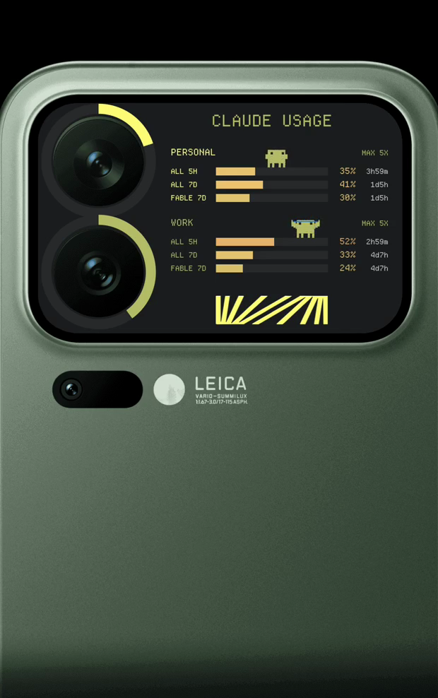
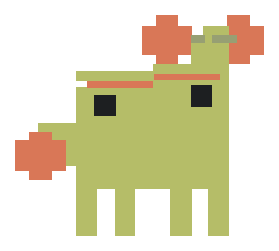
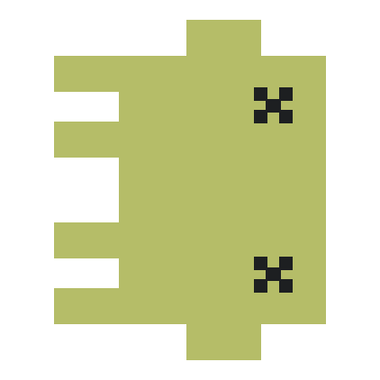

# Claude usage, on the back of the phone

Your Claude Code rate limits, live on the Xiaomi 17 Pro's rear display — so you can see
how much of your window is left without unlocking anything, opening anything, or asking.



*[Watch it run](docs/media/rear-panel.mp4) — 17 seconds, every state.*

Two accounts, three windows each, and a mascot that tells you the state at a glance from
across a desk.

> **Read [Please read this first](#please-read-this-first) before you sign in.** This is a
> personal project that handles account credentials and talks to an API on your behalf.

---

## What it shows

| | |
|---|---|
| **Rings** | Time until the 5-hour window resets. A ring is a *clock*, not a gauge — it fills as the window runs out, and a full ring is good news. Drawn concentric with the camera lenses. |
| **Bars** | Utilisation of each window: the 5-hour session, the 7-day all-models limit, and the 7-day limit for one scoped model. Green through to red as they fill. |
| **Percentages** | The reading itself, and beside it the time until that window resets. |
| **Mascot** | The state, as a picture. One per account, standing on its own 5-hour bar. |

Values animate between readings rather than snapping, so a change catches your eye
without you watching for it.

## The mascot

| | state | shown when |
|---|---|---|
|  | **walk** | Idle. It walks the length of its own bar and back. |
|  | **lifting** | 1% or more of the window went in the last ten minutes. You are working. |
|  | **flag** | The 5-hour window is past 90%. |
|  | **confetti** | The window is at 0% — a fresh start. |
|  | **dead** | The 7-day window is spent. Nothing left to celebrate a fresh 5-hour window with. |

The last one is keyed on the **weekly** limit specifically, because that is the one you
cannot wait out. A 5-hour window refills every five hours, so at the moment one rolls
over you have a session at 0% and a week at 100% — and a mascot throwing confetti at an
account with nothing left to spend.

## On the front screen too

An ongoing notification carries both accounts, and on HyperOS it drives the **HyperIsland**
around the front camera:

```
CLAUDE USAGE
PERSONAL 100% · WORK 38% · ALL 5H resets 9m / 49m
```

Separate warnings fire at half of a limit, then at 90% and every 2% after that.

---

## Requirements

- **A Xiaomi 17 Pro.** The rear display's size, position and lens geometry are measured
  into this app. It will not do anything useful on another phone.
- **HyperOS 3** (Android 16). Developed and verified against `3.0.318.0`.
- **[Shizuku](https://shizuku.rikka.app/)**, running. The rear panel cannot be reached by
  an ordinary app — see below.
- A Claude account with Claude Code access.

## Please read this first

**THIS PROJECT IS NOT AFFILIATED WITH, ENDORSED BY, OR CONNECTED TO ANTHROPIC, OPENAI, OR
XIAOMI IN ANY WAY.** It is a personal project by one person. "Claude" and the Claude
mascot belong to Anthropic; "Codex" belongs to OpenAI. Their appearance here is
description and fidelity, not affiliation.

**THIS APP COLLECTS NO DATA. NONE.** There is no analytics, no telemetry, no crash
reporting, and no server belonging to this project. You can check that claim rather than
trust it — the only network destinations in the entire source are:

```
https://claude.ai/oauth/authorize     sign-in
https://api.anthropic.com/            your usage figures
https://platform.claude.com/          your plan tier
```

Your usage figures never leave your phone, and the panel's broadcast payload carries
readings and timestamps only — never a credential.

**YOUR CREDENTIALS ARE STORED ON YOUR DEVICE AND THEIR SAFETY IS YOUR RESPONSIBILITY.**
Tokens are encrypted with AES-GCM under a key held in the Android Keystore and kept in
this app's private storage. That is a reasonable standard and it is not a guarantee. **ON
A ROOTED, COMPROMISED, OR OUT-OF-DATE DEVICE, OR IN THE FACE OF AN ANDROID VULNERABILITY
OR MALICIOUS APP, THOSE CREDENTIALS CAN BE READ OR STOLEN.** If you lose a token, or a
device, that is on you. Revoke it from your Claude account and move on.

**USING A TOKEN OUTSIDE THE OFFICIAL CLIENT MAY BREACH YOUR PROVIDER'S TERMS, AND YOUR
ACCOUNT COULD BE SUSPENDED OR DISABLED FOR IT.** This has not happened to anyone using
this app so far as I know, and I do not expect it to — it reads your own usage figures
from the same endpoints the official tooling uses. But I cannot speak for Anthropic, they
may take a different view at any time, and **I ACCEPT NO LEGAL OR FINANCIAL
RESPONSIBILITY FOR A SUSPENDED, DISABLED, OR RESTRICTED ACCOUNT, FOR LOST OR STOLEN
CREDENTIALS, OR FOR LOST DATA OF ANY KIND.** Sharing a token across devices or people
makes that risk materially worse. Do not.

**NO WARRANTY.** See [LICENSE](LICENSE). Use it because you want this on the back of your
phone, understanding all of the above.

## Setup

1. **Install Shizuku** and start it. Wireless debugging is the usual route; Shizuku's own
   documentation covers it better than this README could.
2. **Build and install:**
   ```bash
   ./build-install.sh
   ```
3. **Sign in.** Open the app and either log in through your browser, or paste a token if
   your account is managed and device login is impractical.
4. **Turn off battery restrictions** for the app. Android will otherwise stop the poll
   service and the panel will freeze on its last reading.
5. **Background the app, then tap its notification** to put the panel on the back.

Step 5 is the awkward one and it is known — see the roadmap.

## How it works

The rear display refuses to host an activity launched directly at it. So the app launches
its panel on the main display, then asks Shizuku — running as shell — to move that task
across:

```
am start …                 launch on display 0
am display move-stack …    move the task to the rear display
input -d 1 keyevent WAKEUP wake the panel
```

That second command used to be a raw binder transaction number. Do not go back to it:
transaction numbers are positional in the AIDL and Android 16 moved this one, after which
the call kept reporting success while doing nothing at all.

The panel lives in its own `:rear` process, which the system destroys and recreates
constantly. It holds no state — everything it draws arrives in one payload, so a respawned
panel is never briefly wrong.

The display is always-on with no idle timeout, which is close to worst-case burn-in
geometry for OLED. The whole composition drifts by ±4px on a ten-minute
cycle, and the rings — which must stay concentric with the lenses — instead breathe their
radius by ±3px. That is load-bearing, not decoration.

## Configuration

Not yet. Titles — including the masthead — colours, bar order, ring meaning, the bottom
artwork and the number of accounts are all currently compiled in. Making them
configurable is the next piece of work.

## Roadmap

Coming, not here yet:

- **ChatGPT Codex** — a second provider beside Claude, so one panel covers both.
- **Android widget** — the same readings on the home screen.
- **iOS widget.**
- **macOS widget.**
- **Configuration** — everything under Configuration above.
- **Automatic show-on-rear**, so step 5 of the setup stops being a manual step.

## Regenerating the media

```bash
python3 tools/rear-demo.py       # record the panel and composite it into the phone photo
python3 tools/mascot-stills.py   # re-render the state stills above
```

The compositing geometry, and how each number was measured, is in
[`docs/media/README.md`](docs/media/README.md).

## Attribution

The mascot is **Anthropic's Claude mascot**. The animations were extracted from
[ayotomcs.me/claude-mascot](https://ayotomcs.me/claude-mascot) and rebuilt as pixel data
and, for the walk, as a reimplementation of its GSAP timeline. The maker's mark on the
panel is **ACRNM**'s. Neither is my work and neither is covered by this repository's
licence — they are included for fidelity to the design the panel was built around. If you
own either and would rather they were not here, open an issue and I will remove them.

The typeface is [Departure Mono](https://departuremono.com/) by Helena Zhang.

## Licence

MIT, for the code — see [LICENSE](LICENSE). The third-party artwork named above is
explicitly **not** covered by it.
